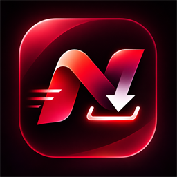
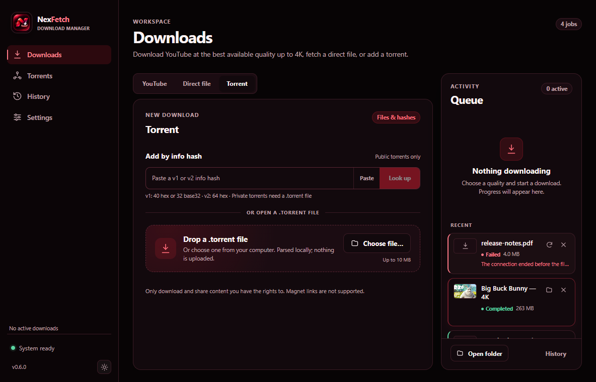
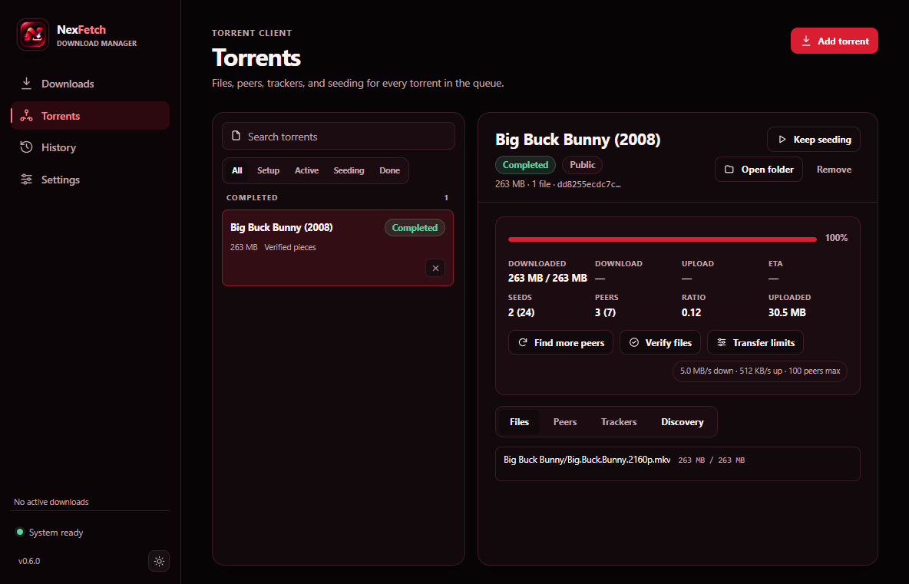
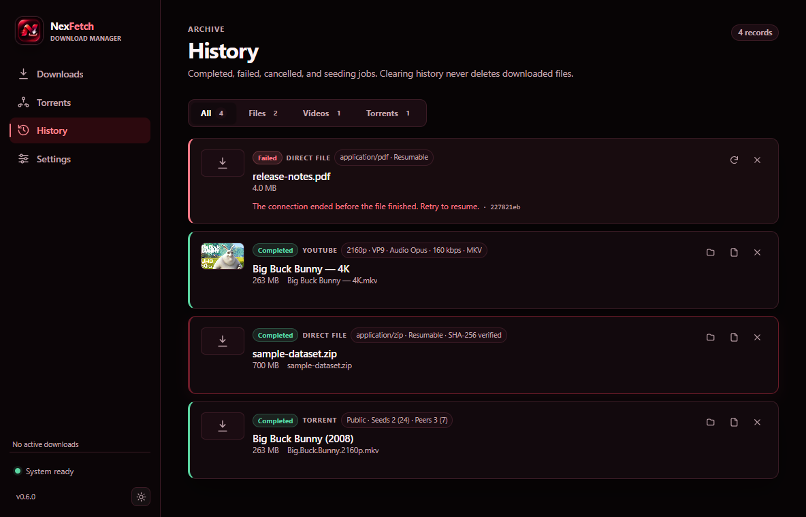
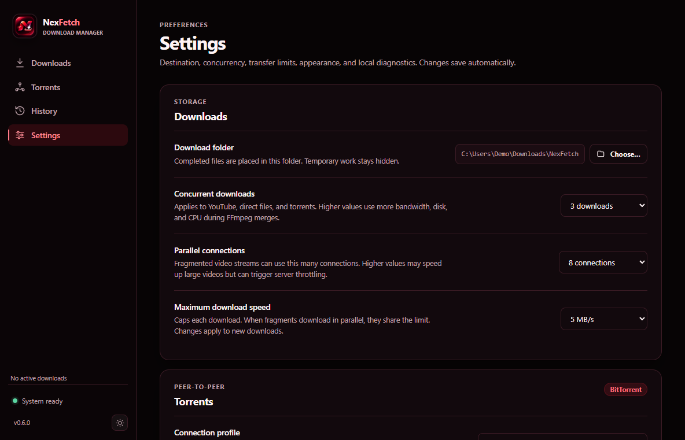
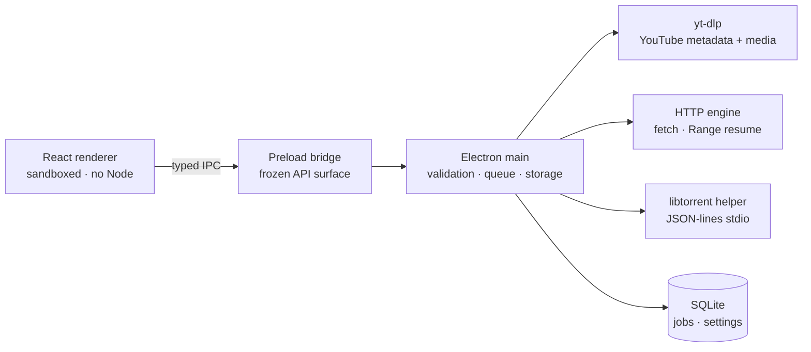

<div align="center">
  
  <h1>NexFetch</h1>
  <p><strong>A calm, secure, universal download manager for Windows.</strong><br />
  YouTube · Direct files · BitTorrent — one queue, one history.</p>
</div>

<p align="center">
  <a href="https://github.com/shubhabrata19/NexFetch/releases/latest">
    
  </a>
</p>

<p align="center">
  
  
  
  
  
  
</p>

> [!WARNING]
> Release builds are currently **unsigned previews**. Windows SmartScreen will
> warn about an unknown publisher. Verify `SHA256SUMS.txt` before running any
> installer. See the [release process](docs/release-process.md) for the policy.

## Screenshots

<p align="center">
  
  
</p>
<p align="center">
  
  
</p>

## What it does

| ▶️ YouTube                                                                                                                                               | 🌐 Direct files                                                                                                                                                         | 📦 BitTorrent                                                                                                                                                  |
| :------------------------------------------------------------------------------------------------------------------------------------------------------- | :---------------------------------------------------------------------------------------------------------------------------------------------------------------------- | :------------------------------------------------------------------------------------------------------------------------------------------------------------- |
| Actual formats up to **2160p**<br />Best-up-to-4K, manual, or audio-only<br />FFmpeg merge + ffprobe verification<br />Parallel fragments and speed caps | HEAD-first probing, bounded redirects<br />Range resume with ETag/Last-Modified checks<br />Optional SHA-256 verification<br />Pause/resume and conflict-safe filenames | `.torrent` files and v1/v2 info hashes<br />Metadata-only DHT lookup<br />File selection, peers, trackers, verification<br />Explicit, user-controlled seeding |

One queue, one history, and one SQLite database power all three engines. Torrent
metadata is sanitized before use, downloads are confined to the destination you
choose, and nothing leaves your machine — **no telemetry, no accounts, no cloud**.

## Download

[**Download the latest release →**](https://github.com/shubhabrata19/NexFetch/releases/latest)

1. Open the latest release and download `NexFetch Setup <version>.exe` plus
   `SHA256SUMS.txt`.
2. Verify the installer (PowerShell):

   ```powershell
   certutil -hashfile "NexFetch Setup <version>.exe" SHA256
   ```

   The result must match the line in `SHA256SUMS.txt`. If it does not, do not run
   the file.

3. Run the installer. SmartScreen's unknown-publisher warning is expected for
   unsigned previews.

NexFetch never auto-updates. **Settings → Check for updates** opens this same
release page.

## Build from source

<details>
<summary><b>Development setup</b> (Node 24+, Python 3.12 for the torrent helper)</summary>

```bash
npm ci
npm run fetch:win-binaries   # pinned, SHA-256 verified yt-dlp + FFmpeg
npm run build:torrent-helper # local libtorrent helper (PyInstaller)
npm run dev
```

Useful commands:

| Command                                          | Purpose                                             |
| ------------------------------------------------ | --------------------------------------------------- |
| `npm run check`                                  | Typecheck, lint, and tests                          |
| `npm run verify:manifest`                        | Validate the pinned binary manifest                 |
| `npm run verify:binaries -- --require-installed` | Verify installed binaries                           |
| `npm run screenshots`                            | Capture README screenshots from an isolated profile |
| `npm run package:win`                            | Build the Windows installer                         |
| `npm run release:checksums -- release/<version>` | Write `SHA256SUMS.txt`                              |

Development builds resolve tools from `resources/bin/<platform>-<arch>/`, then
`PATH`, and accept `NXF_YTDLP_PATH`, `NXF_FFMPEG_PATH`, `NXF_FFPROBE_PATH`, and
`NXF_TORRENT_HELPER_PATH` overrides. Packaged builds only use bundled,
integrity-verified binaries.

</details>

## How it works



The renderer never receives filesystem, shell, or process access. The main process
validates every IPC request, spawns child processes without a shell, and verifies
output paths before finalization. Read
[architecture](docs/architecture.md) for the full design.

## Security by default

| Guarantee              | Implementation                                                       |
| ---------------------- | -------------------------------------------------------------------- |
| Renderer isolation     | `sandbox`, `contextIsolation`, no Node integration, strict CSP       |
| Narrow attack surface  | Frozen preload API, sender-checked IPC, Zod validation               |
| Safe execution         | Argument arrays, `shell: false`, environment allowlist               |
| Trustworthy binaries   | Pinned versions, SHA-256 verified at fetch and startup               |
| Safe filesystem writes | Workspace confinement, path-traversal rejection, conflict-safe names |
| Untrusted torrent data | Bounds-checked bencode, tracker/IP filtering, metadata sanitization  |
| Local by design        | No telemetry, no accounts, redacted local logs with rotation         |

Security issues should be reported privately — see [SECURITY.md](SECURITY.md).

## Supported sources

| Source       | Accepted                                                                        | Not accepted                                                   |
| ------------ | ------------------------------------------------------------------------------- | -------------------------------------------------------------- |
| YouTube      | Watch, `youtu.be`, Shorts, live links, embed, mobile, Music, `youtube-nocookie` | Playlists, channels, search pages, private/members-only videos |
| Direct files | `http://` and `https://` links                                                  | Links with embedded credentials, HTML pages                    |
| BitTorrent   | `.torrent` files, v1/v2 info hashes (DHT metadata lookup)                       | Magnet links, torrent search/indexing                          |

NexFetch does not bypass DRM, paywalls, private-video restrictions, or geo-blocks.
Only download content you own or are permitted to download.

## Roadmap

| Status     | Item                                                                       |
| ---------- | -------------------------------------------------------------------------- |
| ✅ Shipped | YouTube up to 4K, direct HTTP/HTTPS, BitTorrent, unified queue and history |
| ✅ Shipped | Pinned/verified binaries, CI, CodeQL, Dependabot, release checksums        |
| 🔜 Next    | Code signing and notarization, tag-driven signed releases                  |
| 🔜 Next    | Package-manager distribution (winget/Scoop)                                |
| 🧭 Later   | Cross-platform packaging, local-swarm end-to-end tests                     |

## Documentation

- [Features](docs/features.md) — every capability and limitation in detail.
- [Architecture](docs/architecture.md) — process boundaries, engines, storage,
  security model.
- [Release process](docs/release-process.md) — checksums, unsigned-preview policy,
  and the signing gate.
- [Bundled binaries](resources/README.md) and
  [third-party notices](resources/licenses/THIRD-PARTY-NOTICES.md).
- [Torrent helper protocol](tools/torrent-helper/README.md).
- [Security policy](SECURITY.md).

## Responsible use

NexFetch does not include DRM circumvention, paywall bypass, private-video access,
credential theft, or geo-restriction bypass. Only download content you own or are
permitted to download. You are responsible for complying with copyright law, the
terms of service of the source site, and local law. The project is not affiliated
with YouTube or any other source platform.

## License

NexFetch is licensed under the [Apache License 2.0](LICENSE). See [NOTICE](NOTICE)
for bundled third-party components:

- [yt-dlp](https://github.com/yt-dlp/yt-dlp) — Unlicense
- [FFmpeg](https://ffmpeg.org) (LGPL build) — LGPL-3.0-or-later
- [libtorrent](https://libtorrent.org) — BSD-3-Clause
- [Electron](https://www.electronjs.org), [React](https://react.dev) — MIT

<p align="center"><sub>Built for people who want one dependable download queue — not five browser extensions.</sub></p>
