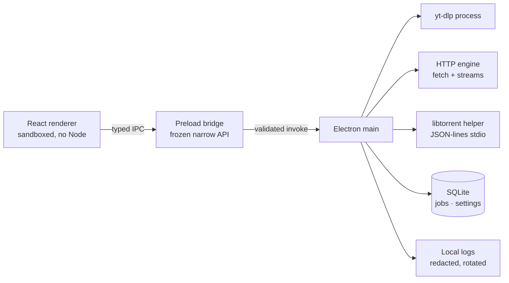

# Architecture

NexFetch is an Electron application with a sandboxed React renderer, a narrow
preload bridge, and a main process that owns downloads, persistence, and child
processes. Engines are independent adapters behind one queue.

## Process boundaries



- **Renderer** — React UI, presentation state only. No filesystem, shell, process,
  or raw Electron access.
- **Preload** — `contextBridge` exposing explicit application functions (never a
  generic dispatcher). API surface: `src/shared/ipc/api.ts`.
- **Main** — window lifecycle, IPC validation, dialogs, settings, queue,
  persistence, dependency verification, and engine supervision.
- **Shared** — domain types, IPC contracts, Zod validation, filename/path policy,
  and pure selection logic used by both processes.

See [features](features.md) for behaviour and
[the security policy](../SECURITY.md) for the threat model.

## Download flow

1. A source is classified by the engine registry (YouTube URL, HTTP/HTTPS URL,
   `.torrent` file, or info hash). Higher-priority engines can block generic
   fallbacks; ambiguity is rejected.
2. The engine produces a preview and a short-lived preview token. The main
   process caches at most 20 previews for 15 minutes.
3. A job stores a typed `DownloadEngine` selection plus normalized metadata in
   SQLite. The shared queue schedules it.
4. The engine writes into a per-job workspace under
   `<destination>/.nexfetch-tmp/<jobId>` (except torrents, which write directly to
   their destination). Output paths are re-verified before finalization.
5. Completion moves the output into the destination with conflict-safe names;
   cancellation removes the workspace.

## Engine contract

Each adapter declares capabilities rather than pretending every protocol supports
the same operations:

| Engine     | Preview         | Formats        | Pause/resume      | Checksum           | Seeding  |
| ---------- | --------------- | -------------- | ----------------- | ------------------ | -------- |
| YouTube    | Yes             | Yes            | No (cancel/retry) | No                 | No       |
| HTTP       | Yes             | No             | Yes               | Optional SHA-256   | No       |
| BitTorrent | Metadata lookup | File selection | Yes               | Piece verification | Explicit |

The core owns job identity, scheduling, retries, persistence, verification calls,
and UI events. Engines own protocol transfer behaviour and protocol-specific
details.

## Child processes and safety

- All child processes use argument arrays with `shell: false`; no shell-string
  interpolation.
- A restricted environment allowlist is passed to `yt-dlp`, FFmpeg, ffprobe, and
  the torrent helper.
- yt-dlp receives only a canonical `https://www.youtube.com/watch?v=<id>` URL
  derived from a host-validated input.
- Magnet URIs are parsed locally. Only the canonical info hash, a sanitized
  display name, and scheme-filtered trackers cross the process boundary; the
  helper rejects trackers that resolve to private or local hosts.
- The torrent helper is spawned by the main process and communicates over
  stdin/stdout only. It has no sockets, HTTP API, or web UI.
- Bundled yt-dlp/FFmpeg/ffprobe binaries are pinned in
  [`resources/binaries.manifest.json`](../resources/binaries.manifest.json),
  verified during fetch, and re-hashed at startup. The locally built torrent
  helper is presence-checked but not hash-pinned.

## Persistence

SQLite schema (`src/main/storage/migrations.ts`):

- `jobs` — indexed columns plus a JSON payload validated by
  `normalizePersistedJobRecord` on read.
- `job_attempts` — per-attempt status/timestamps.
- `settings` — single JSON row.
- `meta` — migration markers (for example, one-time JSON job import).

Schema upgrades create a `VACUUM INTO` backup before migrating. A corrupt database
is moved aside and recreated rather than crashing the app.

## Security baseline

- `app.enableSandbox()`, `contextIsolation: true`, `nodeIntegration: false`,
  `sandbox: true`.
- Strict production CSP injected through `session.webRequest.onHeadersReceived`;
  all permission requests denied.
- New windows, external navigation, and webviews blocked.
- IPC handlers verify sender ID and main-frame identity, then Zod-validate.
- Errors returned to the renderer are generic; diagnostics stay in local logs.
- The logger redacts token/secret/password/cookie/authorization/api-key keys and
  rotates at 5 MB.
- Downloads are confined to the user-selected destination with traversal checks
  at every finalization boundary.

## Repository map

```text
src/
  main/       Electron main process, IPC, services, engines, storage
  preload/    contextBridge surface
  renderer/   React UI
  shared/     domain, IPC contracts, validation, security helpers
tools/
  torrent-helper/  Python libtorrent JSON-lines helper
tests/        Vitest unit tests
resources/    pinned binary manifest, licenses, assets
docs/         features, architecture, release process, screenshots
scripts/      binary fetch/verify, checksums, screenshots, icon generation
```

## Testing

Vitest covers engine selection, URL validation, quality policy, filename safety,
HTTP resume logic, torrent limits/hashes, SQLite persistence, process supervision,
preview caching, and the pinned-binary integrity checks. The release workflow
revalidates the manifest and installed binaries before packaging.
